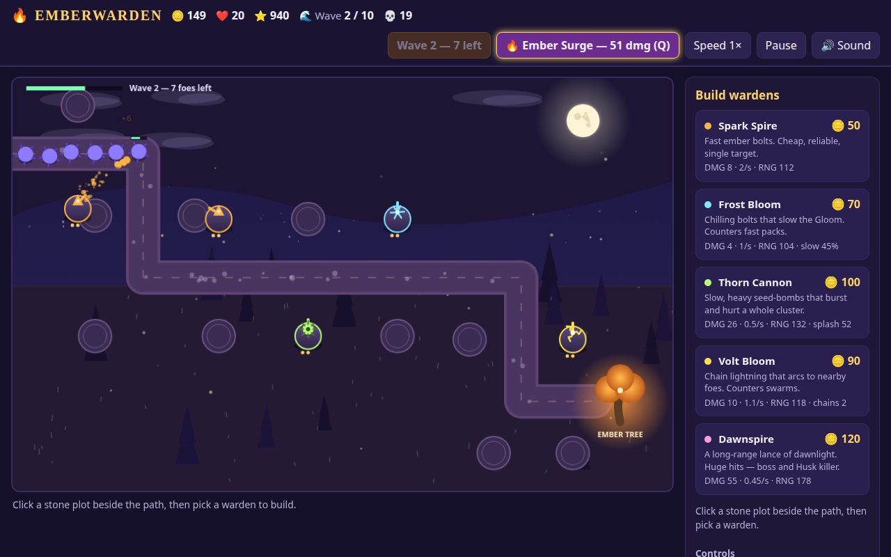

# Emberwarden

[](https://make.fun/bounty/best-game-01)
[](https://make.fun/bounty/best-game-01)
[](https://make.fun/bounty/best-game-01)

Emberwarden is a tower-defense game built for make.fun's
[Make the best game](https://make.fun/bounty/best-game-01) bounty.
Defend the last Ember tree: five tower types, seven enemy kinds, ten
waves, elites, a boss that enrages, an Ember Surge ability, targeting
priorities, upgrades, selling, speed-up and pause — all running offline
from static files, no network requests.

## Play

Serve `game/` with any static HTTP server and open `game/index.html` in
desktop Chrome:

```sh
npx serve game
```

or run the bundled entry program, which hands the game in:

```sh
mkdir -p out && MAKEFUN_OUTPUT_DIR=out node main.ts
```

## How it plays

- Place towers on the map to stop enemies reaching the Ember tree.
- Five tower types with different range, damage and cost: Spark (fast),
  Frost (slows), Thorn (splash), Volt (chain lightning), Dawn (long-range
  boss killer). Each tower can hunt First, Strong or Last.
- Seven enemy kinds: Mote, Wisp, Husk, Shade (slow-immune), Emberling
  swarms, regenerating Wraiths, and the Gloom Matriarch boss — who
  enrages below half health. From wave 4, elite foes (★) pay double bounty.
- Earn gold for every enemy destroyed; spend it on new towers or upgrades.
- Sell towers to refund part of their cost.
- Ember Surge (Q): once per wave, dawnlight strikes every foe on the path.
- Ten waves, ending in a boss. Win by surviving all ten — graded 1–3 stars
  by lives left; lose if the Ember tree falls.
- Keyboard and mouse controls, HUD with wave, gold, lives and score,
  boss health bar, wave progress, start and restart.

## Screenshots





## License

MIT — see [LICENSE](LICENSE).
