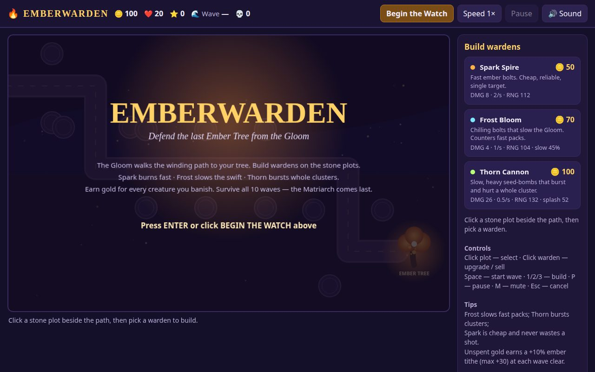
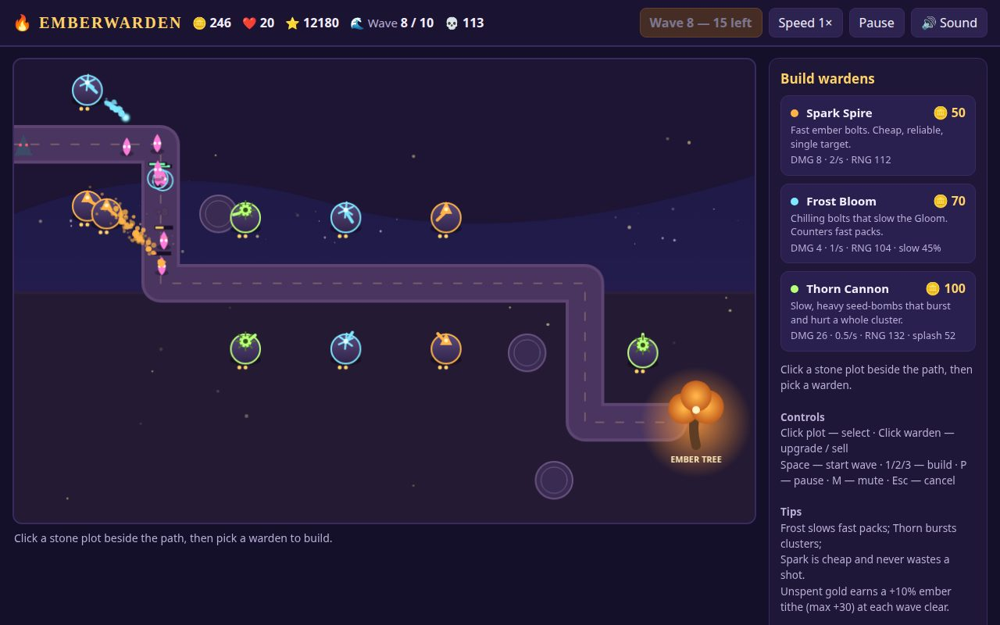
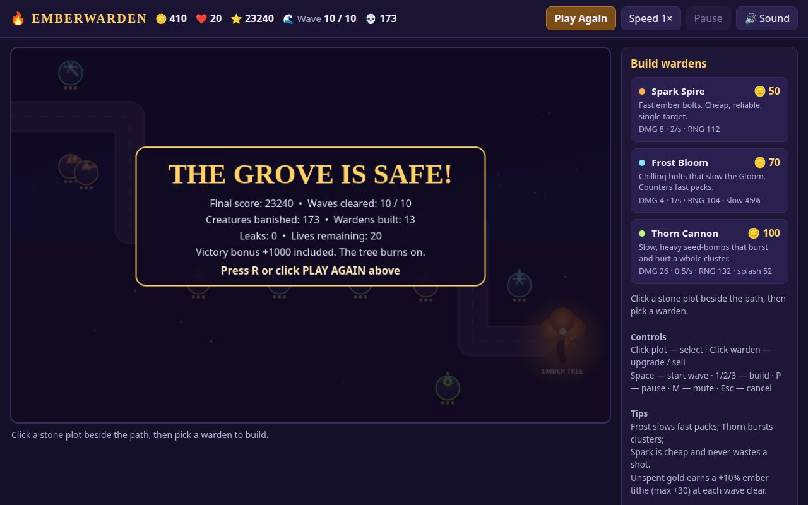

# Emberwarden

[](https://make.fun/bounty/best-game-01)
[](https://make.fun/bounty/best-game-01)
[](https://make.fun/bounty/best-game-01)

Emberwarden is a tower-defense game built for make.fun's
[Make the best game](https://make.fun/bounty/best-game-01) bounty.
Defend the last Ember tree: three tower types, ten waves, a final boss,
upgrades, selling, speed-up and pause — all running offline from static
files, no network requests.

## Play

Serve `game/` with any static HTTP server and open `game/index.html` in
desktop Chrome:

```sh
npx serve game
```

or run the bundled entry program, which hands the game in:

```sh
mkdir -p out && MAKEFUN_OUTPUT_DIR=out node main.ts
```

## How it plays

- Place towers on the map to stop enemies reaching the Ember tree.
- Three tower types with different range, damage and cost.
- Earn gold for every enemy destroyed; spend it on new towers or upgrades.
- Sell towers to refund part of their cost.
- Ten waves, ending in a boss. Win by surviving all ten; lose if the
  Ember tree falls.
- Keyboard and mouse controls, HUD with wave, gold, lives and score,
  start and restart.

## Screenshots






## License

MIT — see [LICENSE](LICENSE).
